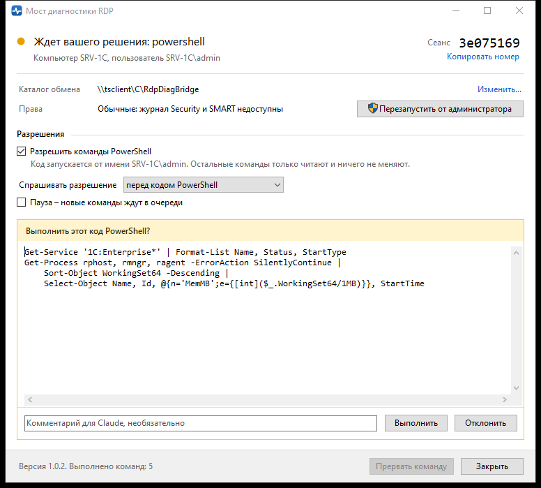

# RdpDiagBridge – мост диагностики удаленного компьютера через RDP

MCP-сервер и агент в одном EXE. ИИ-агент (Claude Code или другой клиент MCP) осматривает удаленный компьютер
Windows, к которому вы подключены по RDP: журналы событий, диски и SMART, службы, процессы, сеть, обновления,
сервер 1С. На удаленный компьютер ничего не ставится, сетевые порты не открываются, учетные данные агенту не
передаются.

## Как это работает

RDP умеет показывать диски вашего компьютера на удаленной стороне как `\\tsclient\C`. Через эту папку и идет обмен:

1. На вашем компьютере клиент MCP запускает `RdpDiagBridge.exe --mcp`. Сервер кладет команды файлами JSON в каталог
   обмена `C:\RdpDiagBridge`.
2. На удаленном компьютере вы запускаете тот же EXE без ключей прямо из `\\tsclient\C\RdpDiagBridge\agent`.
   Открывается окно агента. Он забирает команды, выполняет их и кладет ответы в тот же каталог.
3. Закрыли окно агента – сеанс закончен, его каталог удален.

Связь держится только на RDP-сеансе: нет сеанса, нет и доступа.



## Требования

- Удаленный компьютер: Windows с .NET Framework 4.5 или новее (есть в Windows 8 / Server 2012 и новее, на
  Windows 7 / Server 2008 R2 ставится отдельно).
- Ваш компьютер: Windows с .NET Framework 4.5+, клиент MCP со связью по stdio.
- В подключении RDP включен диск C: «Локальные ресурсы – Подробнее – Диски».

Проверено на Windows 10 и на Windows Server 2016 в настоящих RDP-сеансах, в том числе с правами администратора и на
серверах 1С с MS SQL. На Windows 7, Server 2008 R2, Server 2012 и Windows 11 не проверялось.

## Установка

1. Скачайте `RdpDiagBridge.exe` со страницы [Releases](../../releases) и положите в любую папку, например
   `C:\Tools\RdpDiagBridge`.
2. Подключите MCP-сервер. Для Claude Code:

   ```
   claude mcp add rdp-diag-bridge -- C:\Tools\RdpDiagBridge\RdpDiagBridge.exe --mcp
   ```

   или вручную в `.mcp.json` проекта:

   ```json
   {
     "mcpServers": {
       "rdp-diag-bridge": {
         "command": "C:\\Tools\\RdpDiagBridge\\RdpDiagBridge.exe",
         "args": ["--mcp"]
       }
     }
   }
   ```

3. Перезапустите клиент MCP. При первом запуске сервер создаст `C:\RdpDiagBridge` и положит копию EXE в
   `C:\RdpDiagBridge\agent`.

Переменные среды MCP-сервера (блок `env` в `.mcp.json`):

| Переменная | Назначение | По умолчанию |
|---|---|---|
| `RDP_DIAG_BRIDGE_DIR` | каталог обмена | `C:\RdpDiagBridge` |
| `RDP_DIAG_BRIDGE_RESULTS` | куда складывать большие ответы | `%LOCALAPPDATA%\rdp-diag-bridge\results` |

Если каталог обмена свой, агенту на удаленном компьютере его нужно назвать ключом `--dir`. Агент, запущенный из
папки `agent` внутри каталога обмена, находит каталог сам.

## Как пользоваться

1. Подключитесь к удаленному компьютеру по RDP с диском C.
2. На удаленном компьютере откройте `\\tsclient\C\RdpDiagBridge\agent` и запустите `RdpDiagBridge.exe`. Окно
   агента покажет номер сеанса, каталог обмена и разрешения. Журнал Security, SMART и полные сведения о процессах
   доступны только администратору – для этого есть кнопка «Перезапустить от администратора».
3. Попросите ИИ-агента посмотреть компьютер, например: «посмотри через мост RDP, почему сервер тормозит». Он начнет
   с `sessions` и `health`.
4. Закончив, закройте окно агента.

Если запуск EXE с `\\tsclient` запрещен политикой (AppLocker), скопируйте EXE на удаленный рабочий стол и запустите
оттуда: агент сам найдет `\\tsclient\C\RdpDiagBridge`. EXE не подписан, читает журналы и умеет запускать
PowerShell, поэтому антивирус может его задержать. Тогда нужно исключение или разрешение администратора.

## Что разрешено агенту

Диагностика выполняется без вопросов и ничего не меняет: журналы событий, службы, процессы, диски и SMART, замеры
производительности, сеть и проверка доступности узлов, программы и обновления, задания планировщика, чтение файлов,
сведения о 1С.

Произвольный код PowerShell (инструмент `powershell`) работает, только если в окне агента включено «Разрешить
команды PowerShell». По умолчанию каждый такой код показывается в окне, и вы нажимаете «Выполнить» или «Отклонить»,
при желании с комментарием для ИИ-агента. Можно спрашивать перед каждой командой, включая диагностику, или не
спрашивать совсем. «Пауза» задерживает новые команды, «Прервать команду» снимает выполняемую.

Чего мост не скрывает: результаты диагностики (имена пользователей, адреса, пути, тексты событий) уходят в клиент
MCP и дальше в модель. Запускайте агент только там, где это допустимо.

## Инструменты MCP

| Инструмент | Что делает |
|---|---|
| `sessions` | работающие агенты: компьютер, пользователь, права, Windows, RDP-клиент, разрешения, расхождение часов |
| `ping` | проверка связи, аптайм, расхождение часов |
| `health` | общий осмотр с находками по важности: аварийные выключения и BSOD, место и ошибки дисков, SMART, память и commit, процессор, службы, сбои служб, падения программ, сводка ошибок журналов, устройства, обновления, антивирус, домен/DNS/время, исчерпание портов TCP, лицензирование RDS |
| `sysinfo` | Windows, аппаратная часть, память, диски, пользователи, адреса, .NET и PowerShell, антивирус |
| `events` | события с отбором по журналу, уровню, времени, источнику, кодам, тексту; группировка; список журналов |
| `processes` | процессор за замер, память, дескрипторы; с `details` – командная строка и владелец |
| `services` | службы, по умолчанию проблемные |
| `disks` | тома, физические диски, SMART, задержки и очередь, ошибки дисков в журнале |
| `perf` | замер за N секунд: процессор, память, подкачка, сеть, диски, верхние процессы |
| `network` | адаптеры, TCP по состояниям и процессам, динамические порты, слушающие порты, прокси, hosts, брандмауэр |
| `nettest` | DNS, ping, TCP-порт, HTTP(S) с сертификатом – с удаленного компьютера |
| `software` | программы, обновления, журнал Windows Update |
| `tasks` | задания планировщика с ошибкой последнего запуска |
| `files` | `list`, `tail`, `grep`, `find`, `sizes` |
| `onec` | 1С:Предприятие: платформы, службы и порты, rphost/rmngr, srvinfo, техжурнал, дампы, лицензии, список баз, события 1С |
| `powershell` | код PowerShell с разрешения пользователя |
| `result`, `cancel` | результат долгой команды; снятие или прерывание команды |

## Ключи EXE

- без ключей – агент с окном;
- `--mcp` – MCP-сервер (stdio);
- `--dir <каталог>` – свой каталог обмена;
- `--allow-code`, `--confirm code|all|none` – разрешения агента при запуске;
- `--headless` – агент без окна, останавливается файлом `stop` в каталоге сеанса (для проверок);
- `--call <инструмент> --args-file <json> --out <файл>` – один вызов инструмента из командной строки;
- `--version` – номер версии.

## Сборка

Исходники – C# под .NET Framework 4.x, без внешних библиотек (`src\`). `build.ps1` собирает их компилятором Roslyn
из .NET SDK (нужен любой SDK с `Roslyn\bincore\csc.dll`, проверено на 7.0.202) в `bin\RdpDiagBridge.exe`. Если EXE
занят запущенным MCP-сервером, старый файл переименовывается в `.old-<время>`. Значок и манифест лежат в `res\`;
значок рисует `res\make-icon.ps1`, сборке нужен только готовый `app.ico`.

`tests\run-tests.ps1` запускает агента без окна на этом же компьютере и вызывает все инструменты, затем проверяет
протокол MCP. Протокол обмена описан в [docs/protocol.md](docs/protocol.md).

## Лицензия

[MIT](LICENSE)
